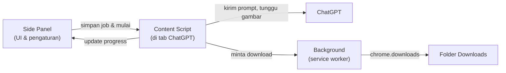

<div align="center">


# ChatGPT Image Batch Generator

Ekstensi Chrome untuk mengirim banyak prompt gambar ke ChatGPT secara berurutan, menunggu gambar selesai dibuat, lalu mendownloadnya otomatis.


</div>

<!-- Tambahkan screenshot di folder docs/ lalu hapus tanda komentar pada baris di bawah -->
<!--  -->

---

## Daftar Isi

- [Tentang](#tentang)
- [Fitur](#fitur)
- [Instalasi](#instalasi)
- [Cara Penggunaan](#cara-penggunaan)
- [Pengaturan](#pengaturan)
- [Hasil Download](#hasil-download)
- [Cara Kerja](#cara-kerja)
- [Struktur Proyek](#struktur-proyek)
- [Troubleshooting](#troubleshooting)
- [Privasi & Izin](#privasi--izin)
- [Batasan & Disclaimer](#batasan--disclaimer)
- [Changelog](#changelog)
- [Lisensi](#lisensi)

---

## Tentang

Membuat banyak gambar di ChatGPT biasanya berarti mengulang hal yang sama berkali-kali: salin prompt, tempel ke kotak chat, tekan Enter, tunggu gambar jadi, download, lalu ulangi untuk prompt berikutnya.

**ChatGPT Image Batch Generator** mengotomatiskan seluruh alur itu. Kamu cukup menulis daftar prompt (satu per baris) atau mengunggah file `.txt`, klik **Mulai**, dan ekstensi akan mengerjakan sisanya satu per satu sampai selesai. Antarmukanya ada di **side panel Chrome** di sisi kanan layar, jadi bisa dibiarkan terbuka sambil proses berjalan.

## Fitur

- **Batch prompt**: ketik langsung (satu prompt per baris) atau upload file `.txt`.
- **Otomatis penuh**: isi kotak prompt, kirim, tunggu gambar selesai, lalu download.
- **Side panel modern & minimalis**: tampil di sisi kanan layar, mengikuti mode terang/gelap sistem.
- **Progress & riwayat**: lihat status, jumlah berhasil/gagal, dan alasan kegagalan per prompt.
- **Stop, Lanjutkan, Reset**: hentikan kapan saja dan lanjutkan dari prompt terakhir.
- **Muat ulang yang gagal**: satu klik untuk memasukkan kembali prompt yang gagal ke kotak prompt.
- **Awalan prompt (opsional)**: tambahkan teks di depan setiap prompt, misalnya `Generate an image:`.
- **Chat baru untuk tiap prompt (opsional)**: setiap prompt dikirim di percakapan baru agar tidak terpengaruh konteks sebelumnya.
- **Pengaturan waktu**: jeda antar prompt, timeout per gambar, dan waktu kirim/enter yang bisa diatur.
- **Download terverifikasi**: ekstensi menunggu download benar-benar selesai dan memastikan isinya gambar, dengan jalur cadangan jika download pertama gagal.
- **Berhenti otomatis** jika 3 prompt gagal berturut-turut (misalnya karena kena batas pemakaian).
- **Pengaturan tersimpan**: isi prompt dan pengaturan tidak hilang saat panel ditutup.

## Instalasi

Ekstensi ini belum ada di Chrome Web Store, jadi dipasang secara manual (mode developer).

**Persyaratan:** Google Chrome **versi 114 atau lebih baru** (untuk fitur Side Panel) dan akun ChatGPT yang bisa membuat gambar.

1. Download proyek ini:
   ```bash
   git clone https://github.com/maxnmrantau/chatgpt-image-batch.git
   ```
   atau klik **Code → Download ZIP** lalu ekstrak.
2. Buka `chrome://extensions` di Chrome.
3. Aktifkan **Developer mode** (pojok kanan atas).
4. Klik **Load unpacked**, lalu pilih folder proyek ini (folder yang berisi `manifest.json`).
5. *(Opsional)* Klik ikon puzzle di toolbar Chrome dan **pin** ekstensi agar ikonnya selalu terlihat.
6. Buka [chatgpt.com](https://chatgpt.com) dan **refresh** tab-nya.

> **Update versi:** timpa folder lama dengan versi baru, klik tombol **Reload** pada ekstensi di `chrome://extensions`, lalu refresh tab ChatGPT.

## Cara Penggunaan

1. Buka **chatgpt.com** dan pastikan kamu sudah login.
2. Klik ikon ekstensi di toolbar. Side panel akan terbuka di sisi kanan layar.
3. Isi daftar prompt, satu prompt per baris:
   ```text
   a cat astronaut floating above the moon, digital art
   a cozy cabin in a snowy forest at sunset
   a futuristic city skyline at night, neon lights
   ```
   Atau klik **Upload .txt** untuk memuat prompt dari file. Baris kosong diabaikan.
4. *(Opsional)* Buka **Pengaturan** dan sesuaikan jeda, timeout, waktu kirim, awalan prompt, atau mode chat baru.
5. Klik **Mulai**.
6. Biarkan tab ChatGPT **tetap terlihat** sampai selesai. Progress dan riwayat tampil di side panel.

Selama proses berjalan, tombol utama berubah menjadi **Hentikan**. Setelah dihentikan, tombol **Lanjutkan** muncul untuk meneruskan dari prompt yang belum selesai.

### Tombol & kontrol

| Kontrol | Fungsi |
|---|---|
| **Mulai / Hentikan** | Memulai batch dari prompt pertama, atau menghentikan proses yang sedang berjalan. |
| **Lanjutkan** | Meneruskan batch dari prompt terakhir yang belum selesai (muncul setelah dihentikan). |
| **Reset** | Menghapus progress dan riwayat. |
| **Muat ulang yang gagal** | Mengganti isi kotak prompt dengan prompt yang gagal saja, supaya bisa dijalankan ulang. |
| **Upload .txt** | Memuat prompt dari file teks (satu prompt per baris). |
| **Kosongkan** | Mengosongkan kotak prompt. |

## Pengaturan

| Pengaturan | Default | Keterangan |
|---|---|---|
| **Jeda (detik)** | 5 | Waktu istirahat antar prompt (ditambah acak 0–2 detik). Tidak berlaku setelah prompt terakhir. Untuk batch besar, 5–10 detik lebih aman. |
| **Timeout (detik)** | 90 | Batas menunggu satu gambar sejak prompt terkirim. Jika lewat, prompt ditandai gagal dan proses lanjut ke prompt berikutnya. Minimum 30. |
| **Waktu kirim / enter (detik)** | 2 | Lama menunggu tombol kirim aktif dan konfirmasi bahwa prompt terkirim, sebelum mencoba cara berikutnya. Rentang 1–8. |
| **Awalan prompt** | kosong | Teks yang ditambahkan di depan setiap prompt. Berguna agar ChatGPT selalu membuat gambar, bukan membalas teks. |
| **Chat baru untuk tiap prompt** | mati | Setelah tiap prompt selesai, ekstensi membuka chat baru dan melanjutkan otomatis di tab yang sama. |

> **Tips:** pembuatan gambar kadang membutuhkan lebih dari 90 detik. Jika banyak prompt gagal karena timeout, naikkan nilainya. Jika prompt kadang terkirim dua kali atau gagal terkirim, naikkan **Waktu kirim / enter**.

## Hasil Download

Gambar disimpan di folder **`Downloads/ChatGPT-Images/`** dengan format nama:

```text
001_a-cat-astronaut-floating-above-the-moon.png
002_a-cozy-cabin-in-a-snowy-forest-at-sunset.png
003_a-futuristic-city-skyline-at-night-neon-lights.png
```

- Nomor urut mengikuti urutan prompt di daftar.
- Nama file memakai versi singkat dari prompt (maksimal 40 karakter, huruf kecil dan angka). Prompt tanpa karakter latin diberi nama `image`.
- Ekstensi file (`png`, `jpg`, atau `webp`) menyesuaikan format gambar dari ChatGPT.
- Jika satu prompt menghasilkan lebih dari satu gambar, ditambahkan akhiran `_1`, `_2`, dan seterusnya.

## Cara Kerja

Ekstensi terdiri dari tiga bagian yang berbagi status lewat `chrome.storage.local`:



Alur untuk setiap prompt:

1. **Menunggu ChatGPT siap** (tidak sedang membuat jawaban lain).
2. **Mengisi kotak prompt** dan memastikan teksnya benar-benar masuk.
3. **Mengirim**: klik tombol kirim; jika belum berhasil, mencoba submit form, lalu menekan Enter. Terkirim atau tidaknya dinilai dari beberapa sinyal sekaligus.
4. **Menunggu gambar**: memantau sampai ChatGPT selesai membuat gambar dan gambar baru stabil (tidak berubah selama 3 detik), atau sampai timeout.
5. **Download**: lewat `chrome.downloads`, menunggu selesai dan memverifikasi isinya gambar. Jika gagal, memakai cadangan (mengambil gambar dari halaman lalu menyimpannya).
6. **Jeda** sesuai pengaturan, lalu lanjut ke prompt berikutnya.

## Struktur Proyek

```text
chatgpt-image-batch/
├── manifest.json     # Konfigurasi ekstensi (Manifest V3)
├── background.js     # Service worker: membuka side panel & menangani download
├── content.js        # Berjalan di tab ChatGPT: kirim prompt, deteksi gambar, loop batch
├── sidepanel.html    # Tampilan side panel
├── sidepanel.js      # Logika UI: input, pengaturan, progress, riwayat
└── icons/            # Ikon ekstensi (16, 32, 48, 128 px)
```

### Jika tampilan ChatGPT berubah

ChatGPT sering memperbarui tampilannya. Elemen yang dicari ekstensi (kotak prompt, tombol kirim, tombol stop) didefinisikan di satu tempat, yaitu objek `SEL` di bagian atas `content.js`. Jika ekstensi berhenti bekerja setelah ChatGPT berubah, perbarui selector di sana.

## Troubleshooting

| Masalah | Penyebab & solusi |
|---|---|
| **"Buka tab chatgpt.com dulu."** | Tidak ada tab ChatGPT yang terbuka. Buka `chatgpt.com` lalu coba lagi. |
| **Tidak terjadi apa-apa setelah klik Mulai** | Refresh tab ChatGPT setelah memasang atau me-reload ekstensi, lalu coba lagi. |
| **"Gagal mengisi kotak prompt"** | Ekstensi tidak berhasil memasukkan teks ke kotak prompt. Pastikan tab ChatGPT terlihat dan tidak ada dialog yang menutupi kotak chat. |
| **"Prompt gagal terkirim (...)"** | Pesan ini menjelaskan keadaannya (tombol kirim ada atau tidak, teks masih di kotak atau tidak). Coba naikkan **Waktu kirim / enter**. Jika tombol kirim "tidak ditemukan", perbarui `SEL.send` di `content.js`. |
| **"Timeout ... (gambar terdeteksi: 0)"** | Gambar belum jadi dalam batas waktu, atau gambarnya tidak terdeteksi. Naikkan **Timeout**. Jika gambar sebenarnya sudah muncul di ChatGPT, kemungkinan struktur halaman berubah. |
| **"Tidak ada gambar: ..."** | ChatGPT membalas teks (misalnya menolak prompt) alih-alih membuat gambar. Gunakan **Awalan prompt** atau ubah isi prompt. |
| **"Download gagal" / "file bukan gambar"** | Download lewat Chrome gagal dan cadangan juga tidak berhasil. Cek izin download Chrome dan pastikan kamu masih login di ChatGPT. |
| **Chrome menanyakan izin "download beberapa file"** | Terjadi pada jalur cadangan. Pilih **Allow** agar download berikutnya berjalan otomatis. |
| **Proses berhenti sendiri** | Berhenti otomatis setelah 3 prompt gagal berturut-turut, biasanya karena batas pemakaian atau perubahan tampilan ChatGPT. |
| **Proses melambat saat tab tidak terlihat** | Chrome memperlambat tab yang tersembunyi. Biarkan tab ChatGPT terlihat, atau buka di window terpisah. |
| **Side panel muncul di kiri** | Ubah di *Chrome Settings → Appearance → Side panel position*. |

## Privasi & Izin

Ekstensi ini **tidak mengumpulkan, menyimpan, atau mengirim data ke server mana pun**. Semua pengaturan, prompt, dan progress disimpan secara lokal di browser lewat `chrome.storage.local`. Tidak ada analitik dan tidak ada permintaan jaringan selain mengambil gambar dari ChatGPT itu sendiri.

| Izin | Kegunaan |
|---|---|
| `storage` | Menyimpan prompt, pengaturan, dan progress secara lokal. |
| `downloads` | Mendownload gambar hasil ke folder Downloads. |
| `scripting` | Memasang script ke tab ChatGPT yang sudah terbuka sebelum ekstensi dipasang atau di-reload. |
| `sidePanel` | Menampilkan antarmuka di side panel Chrome. |
| `chatgpt.com`, `chat.openai.com` | Berjalan di halaman ChatGPT untuk mengisi dan mengirim prompt serta membaca gambar hasil. |
| `*.oaiusercontent.com` | Mengakses file gambar yang di-host OpenAI. |

## Batasan & Disclaimer

- Proyek ini **tidak resmi** dan **tidak berafiliasi dengan, didukung, atau disponsori oleh OpenAI**. "ChatGPT" adalah merek dagang OpenAI.
- Ekstensi bekerja dengan membaca dan mengendalikan antarmuka web ChatGPT. Jika OpenAI mengubah tampilannya, ekstensi bisa berhenti bekerja sampai selector diperbarui.
- Mengirim banyak prompt beruntun akan memakai kuota pembuatan gambar akunmu dan bisa cepat mencapai batas pemakaian. Gunakan jeda yang wajar.
- Otomatisasi antarmuka web mungkin tidak sejalan dengan ketentuan layanan OpenAI. **Gunakan dengan risiko sendiri** dan periksa ketentuan yang berlaku untuk akunmu.
- Ekstensi hanya diuji pada Google Chrome. Browser Chromium lain belum diuji dan mungkin tidak mendukung Side Panel API.

## Changelog

| Versi | Perubahan |
|---|---|
| **1.2.0** | Ikon ekstensi; pengaturan folder download diganti dengan pengaturan waktu kirim/enter (default 2 detik, maks. 8 detik). |
| **1.1.1** | Pengiriman prompt lebih andal: verifikasi pengisian kotak prompt, deteksi terkirim dari beberapa sinyal, tiga cara kirim, dan pesan error yang lebih rinci. |
| **1.1.0** | Antarmuka pindah ke side panel dengan desain modern dan minimalis; timeout default 90 detik; download diverifikasi dengan jalur cadangan; deteksi gambar lebih longgar. |
| **1.0.0** | Rilis awal: batch prompt, kirim otomatis, dan download otomatis. |

## Lisensi

Dirilis di bawah lisensi [MIT](LICENSE).

---

<div align="center">

Dibuat oleh [@maxnmrantau](https://github.com/maxnmrantau)

</div>
